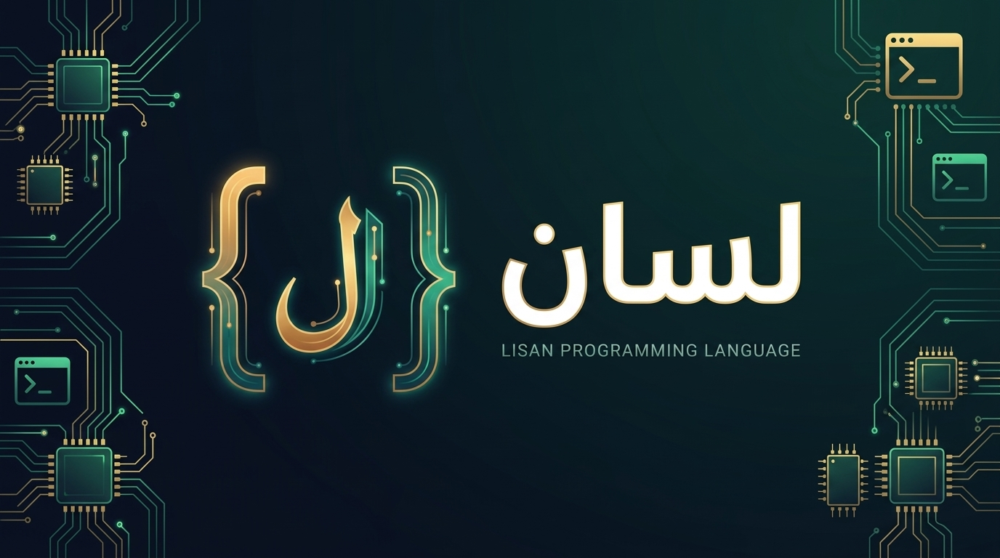

<div align="center" dir="rtl">



# لسان 1.0.0 — لغة البرمجة العربية الشاملة والمنظومة العتادية والسحابية

[](https://codespaces.new/gitmofficiel-dot/lisan)

**لسان (Lisan)** هي لغة برمجة عربية فصيحة وعصرية عالية الأداء تجمع بين سهولة وخفة لغة **بايثون**، وقوة وأمان لغة **Rust**، وسرعة البرامج المترجمة عبر **LLVM/Clang**، مع دعم أصيل لأنظمة **لينكس، ويندوز، ماك**، واللوحات المدمجة **Arduino، ESP32، STM32، وراسبيري باي (Raspberry Pi)**.

</div>

<div dir="rtl">

---

### الميزات الكبرى الجديدة (تكافؤ بايثون):

1. **التقطيع العصري (Slicing):**
   * تقطيع القوائم والنصوص والصفوف بنفس سهولة بايثون مع دعم الخطوات والمؤشرات السالبة:
     ```lisan
     دع أرقام = [10, 20, 30, 40, 50]
     اطبع(أرقام[1:4])     # [20, 30, 40]
     اطبع(أرقام[:3])      # [10, 20, 30]
     اطبع(أرقام[2:])      # [30, 40, 50]
     اطبع(أرقام[::-1])    # [50, 40, 30, 20, 10]
     اطبع("مرحبا بالعالم"[0:5]) # "مرحبا"
     ```

2. **التوليد المختصر (List Comprehensions):**
   * إنشاء وتحويل القوائم في سطر واحد فصيح وأنيق مع التصفية الشرطية:
     ```lisan
     دع مضاعفات = [س * 2 لكل س في مدى(5)]
     دع أعداد_زوجية = [س لكل س في أرقام إذا س % 2 == 0]
     دع حروف = [ح لكل ح في "لسان"]
     ```

3. **المعامل `في` و `ليس في` (`in` / `not in`):**
   * التحقق من الوجود المباشر في القوائم والقواميس والمجموعات والصفوف والنصوص:
     ```lisan
     إذا ("تفاح" في سلة) { اطبع("موجود") }
     إذا ("عمر" ليس في قاموس_المستخدمين) { اطبع("مستخدم جديد") }
     إذا ("عربي" في "محتوى عربي أصيل") { اطبع("صحيح") }
     ```

4. **المعاملات الافتراضية للدوال (Default Arguments):**
   * دوال تقبل قيماً مسبقة التعيين:
     ```lisan
     دالة تحية(اسم, لقب = "سيد") {
         أرجع "مرحبا " + لقب + " " + اسم
     }
     اطبع(تحية("أحمد"))             # مرحبا سيد أحمد
     اطبع(تحية("فاطمة", "أستاذة"))   # مرحبا أستاذة فاطمة
     ```

5. **هياكل البيانات المرجعية والثابتة (Reference Semantics & Data Structures):**
   * **القوائم والقواميس المرجعية:** تعديل مباشر في الذاكرة ومشاركة المراجع (`ب = أ؛ ب.أضف(10)` يعدّل `أ` في مكانها).
   * **طرق التعديل الفورية:** `.أضف()`، `.احذف()`، `.أدرج()`، `.تمديد()`، `.مسح()`، `.نسخ()`.
   * **الصفوف (`صف` / Tuples):** بنية بيانات ثابتة غير قابلة للتعديل (`ص = صف(1, 2, 3)`).
   * **المجموعات (`مجموعة` / Sets):** عناصر فريدة غير مكررة مع عمليات سريعة (`م = مجموعة([1, 2, 2, 3])`).

6. **دوال بايثون القياسية الفصيحة:**
   * `أي(قائمة)`: التحقق من وجود أي عنصر منطقي/موجود (`any`).
   * `كل(قائمة)`: التحقق من صحة كافة العناصر (`all`).
   * `مرقم(قائمة)`: إرجاع قائمة صفوف مع الفهارس (`enumerate`).
   * `سحاب(قائمة1, قائمة2)`: دمج قائمتين في أزواج متقابلة (`zip`).

7. **النصوص المنسقة (f-strings / ن"..." و f"..."):**
   * تضمين المتغيرات والتعبيرات الحسابية مباشرة داخل النصوص بكل سلاسة:
     ```lisan
     دع اسم = "زيد"
     دع عمر = 25
     اطبع(ن"مرحبا {اسم}، عمرك بعد 5 سنوات: {عمر + 5}")
     اطبع(f"المجموع: {10 * 5} ريال")
     ```

8. **فك التعبئة المباشر وفي الحلقات (Unpacking):**
   * توزيع عناصر القوائم والصفوف على متغيرات في خطوة واحدة، ودعم التبديل السريع وتفكيك الأزواج:
     ```lisan
     دع أ، ب = [10, 20]
     أ، ب = [ب، أ] # تبديل مباشر للقيم
     لكل مفتاح، قيمة في قاموس.عناصر() { ... }
     لكل ترقيم، عنصر في مرقم(قائمة) { ... }
     لكل س، ص في سحاب(ق1, ق2) { ... }
     ```

9. **وسائط الدوال المتغيرة (Varargs / `*args`):**
   * دوال تقبل عدداً غير محدد من المعاملات مجمعة في قائمة فصيحة:
     ```lisan
     دالة مجموع_شامل(*أرقام) {
         دع إجمالي = 0
         لكل ر في أرقام { إجمالي = إجمالي + ر }
         أرجع إجمالي
     }
     اطبع(مجموع_شامل(1, 2, 3, 4, 5)) # 15
     ```

10. **مدير السياق (`مع` / Context Manager):**
    * ضمان فتح وإغلاق الموارد والملفات تلقائياً بأمان تام:
      ```lisan
      مع افتح("بيانات.txt", "ك") كـ ملف {
          ملف.اكتب("مرحبا يا لسان")
      }
      # يتم إغلاق الملف تلقائياً فور الخروج من الكتلة
      ```

11. **الوحدات والنطاقات المتقدمة (Namespaced Modules):**
    * تنظيم الكود مع أسماء مستعارة واستيراد انتقائي للمكتبات:
      ```lisan
      استورد رياضيات كـ ر
      اطبع(ر.جذر(25)) # 5
      من رياضيات استورد جا، جتا، ط
      اطبع(جا(0))     # 0
      ```

12. **مكتبة الرياضيات والنظام الشاملة:**
    * الدوال المثلثية: `جا` (`sin`), `جتا` (`cos`), `ظا` (`tan`).
    * اللوغاريتمات والأسس: `لوغاريتم` (`ln`), `أسي` (`exp`).
    * الثوابت العالمية: `ط` ($\pi$), `هـ` ($e$).
    * دوال النظام والعشوائية: `طابع_زمني()`, `نظام_تشغيل()`, `خلط(قائمة)`.

13. **تتبع الأخطاء العربي الفصيح (Traceback):**
    * تقارير أخطاء واضحة تحدد السطر والعمود وسلسلة الاستدعاءات الفصيحة بدقة متناهية.

14. **تشغيل البرامج الحقيقية والخوارزميات الكبرى:**
    * رفع حدود المكدس ليدعم **512 ميغابايت** وحلقات غير محدودة لمعالجة البيانات الكبيرة والخوارزميات المتداخلة.

15. **المنظومة الموسعة المتكاملة:**
    * **برمجة المتحكمات واردوينو:** مترجم كود Arduino C++ ومحاكاة مدمجة مع بيئة Lisan.
    * **بناء تطبيقات الهاتف:** بناء وتصدير تطبيقات الويب التقدمية (PWA) للهواتف الذكية.
    * **واجهات المستخدم والأيقونات:** مكتبة مدمجة لأيقونات SVG ومكونات CSS دون أي تبعيات خارجية.

16. **خادم اللغة الذكي (LSP Server):**
    * خادم لغة قياسي بمعيار JSON-RPC 2.0 للتكامل الفوري مع برامج التحرير مثل VS Code وNeovim.
    * يقدم تشخيصاً فورياً بالأخطاء السطرية والعمودية، وتوثيقاً فصيحاً عند التحويم (Hover)، وإكمالاً تلقائياً ذكياً للكلمات المفتاحية والدوال القياسية.
    * التشغيل عبر: `lisan --lsp` أو `lisan lsp`.

17. **مدير الحزم وقفل النسخ (Package Manager & Lockfile):**
    * إدارة كاملة للمشاريع والتبعيات عبر أمر `lisan حزمة` (أو `lisan --pkg`).
    * تهيئة المشاريع: `lisan حزمة تهيئة [اسم]` مع إنشاء `lisan.json` و`رئيسي.lsn` ومجلد `مكتبات/` وملف القفل الحتمي `lisan.lock`.
    * إضافة المكتبات: `lisan حزمة أضف <اسم> <مسار>` وتحديث ملف القفل تلقائياً.
    * قفل النسخ: `lisan حزمة قفل` لتثبيت التبعيات وحمايتها من التغيير العشوائي.

18. **مكتبة الشبكات والاتصالات (`شبكة` / HTTP & TCP):**
    * إرسال طلبات الويب HTTP GET، الاتصال بمقابس TCP، وتشغيل خوادم ويب مصغرة بدون أي مكتبات خارجية:
      ```lisan
      استورد شبكة كـ ش
      دع رد = ش.طلب_وب("http://api.example.com/data")
      إذا (رد["نجاح"]) {
          اطبع(رد["نص"])
      }
      ```

19. **مكتبة معالجة النصوص وتشفير البيانات (`نصوص`):**
    * تشفير وفك تشفير Base64، ترميز الروابط URL، وحشو النصوص يميناً ويساراً:
      ```lisan
      استورد نصوص كـ ن
      دع مشفر = ن.ترميز_قاعدة64("بيانات سرية")
      دع مفكوك = ن.فك_قاعدة64(مشفر)
      دع رابط = ن.ترميز_url("https://example.com/بحث?س=لسان")
      ```

20. **منسّق الشيفرة الآلي العربي (`lisan نسّق` / `lisan --fmt`):**
    * أداة تنسيق قياسية لترتيب الأسطر، ضبط المسافات حول العوامل، ومحاذاة الكتل البرمجية بمقدار 4 مسافات:
      ```bash
      lisan نسّق ملف.lsn        # تنسيق وحفظ الملف مباشرة
      lisan نسّق --فحص ملف.lsn  # فحص التنسيق في مسارات التكامل المستمر CI
      ```

21. **محرّك الاختبارات المدمج (`lisan اختبار` / `lisan --test`):**
    * تشغيل واكتشاف اختبارات المشاريع تلقائياً (مثل pytest وcargo test):
      ```bash
      lisan اختبار              # اكتشاف وتشغيل جميع ملفات الاختبار في المشروع
      lisan اختبار مسار/ملف.lsn # تشغيل ملف اختبار محدد
      ```
    * يدعم الدوال الاختبارية المعزولة `دالة اختبار_*()` والتحققات المباشرة `تحقق_يساوي()` مع إحصائيات زمنية وتقارير فصيحة.

22. **مكتبة الإحصاء والرياضيات المتقدمة (`إحصاء` و`رياضيات`):**
    * حزمة شاملة للتحليل الإحصائي والعمليات الرياضية الدقيقة:
      ```lisan
      استورد إحصاء كـ ح
      استورد رياضيات كـ ر

      دع درجات = [85، 90، 90، 95]
      اطبع(ح.متوسط(درجات))       # 90
      اطبع(ح.وسيط(درجات))        # 90
      اطبع(ح.منوال(درجات))       # 90
      اطبع(ح.انحراف_معياري(درجات)) # 4.08

      اطبع(ر.مضروب(5))           # 120
      اطبع(ر.توافيق(6، 2))        # 15
      اطبع(ر.قاسم_مشترك(24، 36)) # 12
      ```

23. **مكتبة التاريخ والتقويم وحساب الأيام (`تاريخ`):**
    * توقيت وتقويم دقيق بحسابات شمسية فلكية لمعرفة اليوم والوقت والتحويل بين التواريخ وأيام الأسبوع:
      ```lisan
      استورد تاريخ كـ ت
      دع اليوم = ت.تاريخ_اليوم()        # "2026-11-15"
      دع الوقت = ت.الآن()               # "2026-11-15 13:45:00"
      دع يوم_الأسبوع = ت.يوم_الأسبوع(اليوم) # "الأحد"
      دع فرق = ت.فرق_أيام("2026-12-31"، اليوم)
      دع بعد_أسبوع = ت.أضف_أيام(اليوم، 7)
      ```

24. **مكتبة الجداول والبيانات المجدولة (`csv`):**
    * تحليل وإنشاء وتصدير ملفات وجداول CSV المتوافقة مع معيار RFC 4180:
      ```lisan
      استورد csv كـ جدولة
      دع جدول = جدولة.تحليل_csv("الاسم,العمر\nسعيد,30\nمنى,26")
      دع صفوف = [["رقم", "سعر"], [101, 49.9]]
      دع نص_csv = جدولة.ترميز_csv(صفوف)
      ```

26. **المكتبات الشاملة لكافة قطع المتحكمات الدقيقة والحواسيب المدمجة (83 وحدة عتادية: Arduino / ESP32 / STM32 / Raspberry Pi):**
    * منظومة عتادية قياسية غير مسبوقة باللغة العربية مع محاكاة كاملة ومترجمات C++ وPython 3 جاهزة للرفع المباشر:
    * **أردوينو وكافة الحساسات والقطع (38 صنفاً مدمجاً — `استورد "اردوينو"`):**
      - الحساسات والمدخلات: `قارئ_rfid` (MFRC522)، `لوحة_مفاتيح_4x4`، `عصا_تحكم` (Joystick)، `مشفر_دوار` (KY-040)، `حساس_رطوبة_تربة`، `حساس_مطر`، `حساس_لهب`، `مستقبل_أشعة_ir`، `حساس_تسارع_جيروسكوب` (MPU6050)، `حساس_ضغط_جوي` (BME280)، `خلية_وزن_hx711`، `حساس_صوت`، `حساس_مستوى_ماء`، `حساس_تيار_acs712`، `حساس_ألوان_tcs3200`، `حساس_نبض_max30102`، `حساس_مسافة`، `حساس_حرارة`، `حساس_حركة_pir`، `حساس_غاز_mq`، `محدد_مواقع_gps`، `زر_ضاغط`.
      - الشاشات والمشغلات والتخزين: `شاشة_oled` (SSD1306 128x64)، `شاشة_كريستال` (LCD)، `شاشة_سبع_قطع` (TM1637)، `مصفوفة_ليد_8x8` (MAX7219)، `شريط_إضاءة` (NeoPixel)، `محرك_سيرفو`، `محرك_خطوي`، `متحكم_محركات_l298n`، `مرحل_كهربائي` (Relay)، `جرس_تنبيه`، `بطاقة_ذاكرة_sd`، `ذاكرة_eeprom`، `ناقل_i2c`، `ناقل_spi`، ودالة `إعادة_تشغيل()`.
      - الترجمة المباشرة: `lisan --arduino ملف.lsn --output sketch.ino`
    * **متحكمات ESP32 و ESP8266 لإنترنت الأشياء والكاميرا (18 صنفاً — `استورد "esp32"`):**
      - الأصناف المدمجة: `كاميرا_esp32` (ESP32-CAM OV2640 والبث الحي)، `اتصال_مباشر_espnow`، `عميل_http_esp`، `مقبس_ويب_esp` (WebSockets)، `ذاكرة_تفضيلات_nvs`، `توقيت_شبكي_ntp`، `مهمة_متوازية_rtos` (FreeRTOS ثنائي النواة)، `بلوتوث_تسلسلي_esp`، `تحديث_هوائي_ota`، `واي_فاي_esp`، `خادم_ويب_esp`، `عميل_mqtt`، `بلوتوث_ble`، `حساس_لمس_esp`، `نوم_عميق_esp`، `ذاكرة_فلاش_spiffs`، `محول_تماثلي_esp`، `محول_رقمي_esp`.
      - الترجمة المباشرة: `lisan --esp32 ملف.lsn --output esp_sketch.ino`
    * **متحكمات STM32 الصناعية بمعالجات ARM Cortex-M (15 صنفاً — `استورد "stm32"`):**
      - الأصناف الصناعية: `ناقل_مباشر_dma` (نقل الذاكرة فائق السرعة)، `مراقب_النظام_iwdg` (Watchdog)، `مقاطعة_خارجية_exti`، `مشفر_عتادي_stm32`، `ذاكرة_فلاش_stm32`، `منفذ_usb_cdc`، `ناقل_spi_stm32`، `ناقل_i2c_stm32`، `مؤقت_عتادي_stm32`، `محول_تماثلي_stm32`، `محول_رقمي_stm32` (12-bit DAC)، `ناقل_can_stm32` (CAN Bus)، `ساعة_الوقت_الحقيقي_rtc`، `وضع_توفير_طاقة_stm32`، `منفذ_تسلسلي_stm32`.
      - الترجمة المباشرة: `lisan --stm32 ملف.lsn --output stm32_sketch.ino`
    * **حواسيب راسبيري باي (Raspberry Pi 3 / 4 / 5 / Zero — 12 صنفاً — `استورد "راسبيري"`):**
      - الأصناف العتادية: `لوحة_راسبيري`، `منفذ_gpio_راسبيري`، `نبضة_pwm_راسبيري`، `ناقل_i2c_راسبيري`، `ناقل_spi_راسبيري`، `منفذ_تسلسلي_راسبيري`، `كاميرا_راسبيري` (Picamera2)، `قبعة_الحساسات_sensehat`، `قبعة_محركات_pca9685` (16 قناة سيرفو)، `شاشة_لمس_dsi`، `صوت_راسبيري` (مع نطق عربي TTS)، `شاشة_حبر_إلكتروني_epaper`.
      - الترجمة المباشرة لتطبيق Python 3 تنفيذي لراسبيري باي: `lisan --raspberry ملف.lsn --output app_rpi.py`

      ```lisan
      # مثال راسبيري باي 5: GPIO وكاميرا وقبعة الحساسات SenseHAT
      استورد "راسبيري"
      دع لوحة = جديد لوحة_راسبيري("Raspberry Pi 5")
      اطبع("حرارة المعالج: " + نص(لوحة.حرارة_المعالج()) + " °C")

      دع كاميرا = جديد كاميرا_راسبيري(1920، 1080)
      كاميرا.ابدأ()
      كاميرا.التقط_صورة("capture.jpg")

      دع قبعة = جديد قبعة_الحساسات_sensehat()
      قبعة.اعرض_رسالة("مرحباً من لسان!")
      ```

27. **التشفير القياسي، التعابير النمطية (Regex)، وقاعدة البيانات المدمجة (`قاعدة_بيانات` / `تشفير` / `أنماط`):**
    * **التشفير والأمان (`تشفير_أمان`):** تجزئة `تجزئة_sha256` (معيار FIPS 180-4)، توقيع `توقيع_hmac`، معرفات عالمية `معرف_فريد()` (UUID v4)، وتشفير وفك تشفير النصوص العربية الموثق `شفر_نص` و `فك_تشفير_نص`.
    * **التعابير النمطية العربية والعالمية (`محلل_أنماط`):** `يطابق_نمط`، `استخرج_نمط`، `استبدل_نمط` مع دعم كامل لمحارف العربية وUnicode.
    * **قاعدة البيانات المحلية المستديمة (`قاعدة_بيانات`):** جداول وسجلات وبحث وحذف وحفظ تلقائي بصيغة JSON، بالإضافة إلى `معلومات_النظام()`.

      ```lisan
      استورد "قاعدة_بيانات"
      دع مشفر = شفر_نص("رسالة سرية للغاية بلغة لسان"، "مفتاح_قوي_2026")
      اطبع(فك_تشفير_نص(مشفر، "مفتاح_قوي_2026"))

      دع قاعدة = جديد قاعدة_بيانات("بياناتي.json")
      قاعدة.أنشئ_جدول("المشاريع")
      قاعدة.أدرج("المشاريع"، {"الاسم": "روبوت ذكي"، "اللوحة": "Raspberry Pi 5"})
      اطبع(قاعدة.الكل("المشاريع"))
      ```

28. **بناء وتوليد واستضافة مواقع الويب المتجاوبة بالكامل (`موقع` / `موقع_ويب`):**
    * توفر لغة لسان منظومة متكاملة لإنشاء وتوليد مواقع ويب عصرية متجاوبة باللغة العربية (RTL) بدون أي تبعيات خارجية أو حزم من الإنترنت، مع دعم الأنماط اللونية والوضع الليلي/النهاري ونماذج التواصل التفاعلية وإحصائيات وشبكات البطاقات:
      ```lisan
      استورد "موقع"

      دع موقعي = جديد موقع_ويب("بوابة لسان العربية", "ملكي")
      موقعي.شريط_تنقل("بوابة لسان", "كود")
      موقعي.قسم_رئيسي("أهلاً بكم في لسان", "أول موقع يتم توليده واستضافته بنواة لغة لسان العربية", "ابدأ الآن", "شمس")
      موقعي.أضف_إحصائيات([
          ["السرعة والكفاءة", "100%", "شريحة"],
          ["الأمان التام", "0 تبعيات", "درع"],
          ["دعم العتاد", "83 وحدة عتادية", "أردوينو"]
      ])
      موقعي.حفظ("موقع_لسان.html")
      ```

29. **استوديو لسان لسطح المكتب وبرامج لينكس وويندوز وماك وراسبيري باي (`lisan استوديو`):**
    * يأتي لسان مزوداً ببيئة تطوير متكاملة لسطح المكتب (**Lisan Studio Desktop**) تعمل كتطبيق أصلي على **Linux** و**Windows** و**macOS** و**Raspberry Pi OS**:
      ```bash
      lisan استوديو
      # أو: lisan --studio
      # ولعرض كافة الأنظمة والمنصات المدعومة: lisan منصات
      ```
    * **التثبيت الفوري بأمر واحد على لينكس، ماك، وراسبيري باي (x86_64 & ARM64):**
      ```bash
      curl -sSf https://raw.githubusercontent.com/gitmofficiel-dot/lisan/main/install.sh | sh
      ```
    * **التثبيت الفوري بأمر واحد على ويندوز (PowerShell):**
      ```powershell
      irm https://raw.githubusercontent.com/gitmofficiel-dot/lisan/main/install.ps1 | iex
      ```
    * **بناء الحزم التنفيذية وحزم `.deb` و `.app` و `.zip` محلياً أو عبر GitHub Releases:**
      ```bash
      ./scripts/build-all.sh
      ```


---

</div>

يقدّم الإصدار 0.9.1 تجربة برمجية عربية فائقة السلاسة تشبه تجربة بايثون في السهولة والخفة مع قوة لغة Rust وسرعة الكود المترجم:

- **كتابة كود حرة وعصرية (بدون فواصل منقوطة):**
  * الفاصلة المنقوطة `؛` أصبحت **اختيارية تماماً**؛ اكتب كل أمر في سطر منفصل دون عناء النقاط والفواصل.
  * إمكانية الجمع بين عدة أوامر في سطر واحد باستخدام `؛` عند الحاجة.
- **مصحح الأخطاء والاقتراحات الذكية (Diagnostics):**
  * محرك ذكي يكتشف الأخطاء الإملائية الشائعة في المتغيرات والدوال ومفاتيح القواميس.
  * يقترح التصحيح مباشرة: `(هل تقصد 'النتيجة'؟)` مع مراعاة الفروق العربية الفصحى (`ة`/`ه`، الهمزات، التشكيل، التطويل).
- **التحكم بالتدفق والاستثناءات:**
  * `حاول` و`التقط` و`أخيرًا` لاعتراض ومعالجة الأخطاء بأمان.
  * `ارمِ` لإطلاق الاستثناءات المخصصة.
  * `اختر` و`حالة` و`افتراضي`: بنية الاختيار والمطابقة (Match/Switch) مدعومة في المفسر وأصلياً عبر LLVM IR.
- **تكامل JSON والقوالب:**
  * `تحليل_json(نص)`: تحويل نصوص JSON إلى قواميس وقوائم وقيم لسان، مع دعم `true`/`false`/`null` والرموز العربية `صحيح`/`خطأ`/`لاشيء`.
  * `ترميز_json(قيمة)`: تحويل هياكل البيانات إلى نصوص JSON متوافقة عالمياً.
  * `تنسيق(قالب، قائمة)`: استبدال علامات `{}` بالقيم المحددة.
- **الأرقام والعشوائية (PRNG SplitMix64):**
  * `عشوائي()`: رقم عشري بين 0.0 و 1.0.
  * `عدد_عشوائي(أدنى، أقصى)`: عدد صحيح عشوائي ضمن النطاق.
  * `عنصر_عشوائي(قائمة)`: اختيار عنصر عشوائي من أي قائمة.
- **النظام والبيئة:**
  * `بيئة(اسم)`: قراءة متغيرات بيئة نظام التشغيل.
  * `وسائط()`: جلب وسائط سطر الأوامر للبرنامج.
- **دوال القوائم والمصفوفات:**
  * `عكس(قائمة)`: عكس ترتيب عناصر القائمة (أو النص).
  * `فرز(قائمة)`: ترتيب عناصر القائمة تصاعديًا للأرقام أو النصوص.
  * `مجموع(قائمة)`: حساب مجموع عناصر القائمة العددية (مدعومة أصليًا في LLVM IR).
  * `متوسط(قائمة)`: حساب المتوسط الحسابي للقائمة العددية (مدعومة أصليًا في LLVM IR).
  * `ابحث(قائمة، عنصر)` / `ابحث(نص، كلمة)`: إيجاد موقع الفهرس للعنصر أو النص الفرعي.
- **دوال النصوص المتقدمة:**
  * `يبدأ_ب(نص، بادئة)`: التحقق من بداية النص.
  * `ينتهي_ب(نص، لاحقة)`: التحقق من نهاية النص.
  * `كرر(نص، تكرار)`: تكرار النص N مرات بأمان.
  * `أحرف_كبيرة(نص)` و`أحرف_صغيرة(نص)`: تحويل الحروف اللاتينية.
- **دوال رياضية موسعة:**
  * `أرضية(س)` (`floor`) و`سقف(س)` (`ceil`) مدعومتان أصليًا في LLVM IR عبر دوال النواة (Intrinsics).
  * `قوة(أساس، أس)`: حساب القوة والأس الرياضي.
- **دوال الإدخال والملفات والوقت (المفسّر):**
  * `ادخل(رسالة)`: قراءة سطر من لوحة المفاتيح.
  * `ملف_موجود(مسار)` و`ألحق_ملف(مسار، نص)`: فحص الملفات والإلحاق بها.
  * `الآن()`: الوقت الحالي بالثواني منذ 1970.
  * `عدد_صحيح(قيمة)`: اقتطاع القيمة إلى عدد صحيح.

## خارطة الطريق ومعيار الاكتمال

- خارطة الطريق المرحلية: [docs/ROADMAP.md](docs/ROADMAP.md)
- خط الأساس ومعيار القبول: [docs/COMPLETION-BASELINE.md](docs/COMPLETION-BASELINE.md)
- فروقات مسارات التنفيذ (Interpreter/VM/Native/Build): [docs/EXECUTION-PATHS.md](docs/EXECUTION-PATHS.md)

```bash
cargo test --all-targets
cargo run -- --interpret examples/errors_and_match.lsn
cargo run -- --interpret examples/json_and_random.lsn
```

---

# لسان 0.8.0 — توسيع المترجم الأصلي (AOT)

يدعم مسار LLVM/Clang الآن القوائم **الرقمية**، الفهرسة والكتابة إلى العناصر، حلقات `لكل` على القوائم أو `مدى`، جمع النصوص والمقارنة بينها، وعدّ أحرف UTF-8، ودوال `مطلق` و`جذر` و`قرّب` و`أدنى` و`أعلى`، و`تحقق` و`تحقق_يساوي` على القيم البسيطة. هذا التحديث **لا يضمّ المفسّر** في الملفات الناتجة من `--native`.

```bash
cargo test --all-targets
cargo run -- --native examples/native_collections.lsn --output native-collections
./native-collections
```

**القيود:** لم تكتمل اللغة الأصلية بعد: لا قواميس أو قوائم مختلطة الأنواع أو واجهات شبكات أو مدير حزم أو نظام أنواع كامل؛ لا تُدعم الدوال التي تستقبل نصوصًا أو قوائم بعد. توجد اختلافات في نسخ القوائم وإدارة الذاكرة عن المفسّر القديم، لذلك لا يُعتبر التكافؤ مكتملاً. بعض وظائف النصوص تعتمد على مكتبة C، كما يتطلب البناء وجود Clang.

---

# لسان — تطوير مترجم أصلي (Native Compiler)

**جديد:** تحويل ملفات لسان العربية إلى **برامج آلة أصلية** بلا مفسّر مُضمّن، بواسطة LLVM IR وClang. هذا مسار ترجمة مسبقة (AOT)، وما زال يدعم جزءًا من اللغة، لا كل مكتبات المفسّر القديمة.

```bash
cargo run -- --native examples/native.lsn --output native-program
# أو افتراضيًا: cargo run -- examples/native.lsn
./native-program
cargo run -- --emit-llvm examples/native.lsn --output native.ll
```

اقرأ [دليل المترجم الأصلي](docs/NATIVE-COMPILER.md) للاطلاع على الميزات والقيود؛ لا تزال `--build` القديمة تجمع المفسّر لأغراض التوافق ولا تمثّل الترجمة الأصلية.

---

<div dir="rtl">

# لسان LISAN — نواة موحّدة 0.6.0

لغة برمجة عربية فصيحة قيد التطوير، بنواة مفتوحة المصدر مكتوبة بلغة Rust، وتعمل حاليًا كمفسّر. تستعمل الشيفرة **الأرقام اللاتينية 0-9 فقط**، والفاصلة العشرية `.`، مع دعم الحروف العربية UTF-8.

## جديد الإصدار 0.6.0

- `توقف؛` و`تابع؛` داخل الحلقات مع الكشف المبكر عن سوء الاستخدام.
- عامل الأسّ `**`، والأرقام العلمية مثل `1e3` مع الاستمرار في فرض الأرقام اللاتينية.
- دعم `مدى(بداية، نهاية، خطوة)` للخُطوات السالبة والموجبة.
- فحص نتائج العمليات الحسابية لمنع `Infinity` و`NaN`.
- الدالتان `تحقق` و`تحقق_يساوي` وأمر CLI: `lisan --test examples/testing.lsn`.
- توسيع اختبارات Rust وتمييز الشيفرة ومقاطع VS Code.

## ما اكتمل في هذه النسخة

- المحلل المعجمي (Lexer) والمحلّل النحوي (Parser) وشجرة AST ومفسّر القيم والدوال والشروط والحلقات.
- القوائم والقواميس مع الفهرسة والإسناد، وعمليات حسابية ومنطقية.
- مكتبة قياسية أولية: `طول` و`نوع` و`نص` و`عدد` و`مدى` و`أضف` و`احذف` و`يحتوي` و`مفاتيح` و`قيم` و`قسّم` و`ادمج` و`استبدل` و`اقتطع` و`نظّف` و`مطلق` و`جذر` و`قرّب` و`أعلى` و`أدنى` و`اقرأ_ملف` و`اكتب_ملف`.
- استيراد ملفات `.lsn`، مع كشف الدورات والملفات المكررة.
- CLI: بناء ملف تنفيذي مستقل (`--build`)، تفسير الملفات، REPL، `--check`، `--tokens`، `--ast`.
- اختبارات Rust وتغليف المفسّر لنظام Windows وLinux وmacOS عبر GitHub Actions.
- دعم رسمي متكامل لمحرّر Visual Studio Code وخادم LSP للتلوين النحوي والتكميل التلقائي والتنسيق.
- بيئة تطوير سحابية جاهزة بنقرة واحدة عبر **GitHub Codespaces**.

## التطوير السحابي الفوري عبر GitHub Codespaces

يمكنك البدء في تطوير وتشغيل لغة لسان فوراً دون الحاجة لتثبيت أي برمجيات أو أدوات على جهازك:

[](https://codespaces.new/gitmofficiel-dot/lisan)

عند النقر على الرابط أعلاه، تُهيئ GitHub حاوية سحابية مخصصة تحتوي على:
1. بيئة Rust كاملة وأداة Cargo وأحدث إصدار مستقر من Rust.
2. بناء مسبق لمترجم ومفسر `lisan` وتثبيته مباشرة في المسار العام للنظام ليتاح في الطرفية فوراً.
3. ملحق لسان الرسمي لمحرر VS Code مع التلوين النحوي العربي، وقوالب الشيفرة، وخادم LSP.
4. حزم المتحكمات الدقيقة السحابية: `arduino-cli`، ومترجمات ARM Cortex-M (`gcc-arm-none-eabi`) لمتحكمات STM32، وأدوات ESP32 (`esptool`).
5. دعم كامل لترجمة الويب WebAssembly عبر الهدف `wasm32-unknown-unknown`.
6. منافذ مجهزة مسبقاً لعرض خادم الويب والموقع المولد (المنفذ `8080` والمنفذ `3000`).

## مثال

```text
ليكن البيانات = {"الاسم": "سلمى", "الدرجات": [17, 19, 15]}؛
اطبع("الاسم: " + البيانات["الاسم"])؛
اطبع("المعدل: " + ((17 + 19 + 15) / 3))؛
```

## تشغيل

```bash
cargo test --all-targets
cargo build --release
cargo run -- examples/dictionary.lsn
cargo run -- examples/standard_library.lsn
cargo run -- --check examples/modules/main.lsn
cargo run -- --test examples/testing.lsn
cargo run -- --tokens examples/hello.lsn
cargo run -- --ast examples/hello.lsn
cargo run -- --build examples/modules/main.lsn --output app
```

للحصول على المفسّر الجاهز: [GitHub Actions](https://github.com/naimamiam1234-star/lisan-language/actions) ثم Artifacts، حيث تظهر حزم المفسّر (`lisan-*`) وبرنامج عربي مستقل تجريبي (`lisan-standalone-sample-*`). الأمثلة المصدرية في `examples/`، والنحو في `docs/SYNTAX.md` وسياسة الأرقام في `docs/NUMBERS-AND-STYLE.md`.

## ما يجري العمل عليه للمستقبل

أمر `--build` يولّد ملفًا تنفيذيًا مستقلًا يضم مفسّر لسان والبرنامج بعد دمج الاستيرادات، بينما يوفّر أمر `--native` مسار الترجمة الأصلي عبر LLVM/Clang. كما تم دمج خادم LSP ومدير الحزم `lisan حزمة`. يجري العمل حاليًا على توسيع الأنواع في المترجم الأصلي، ومكتبات الشبكات المتقدمة، وواجهات FFI لربط مكتبات C وRust مباشرة. `اقرأ_ملف` و`اكتب_ملف` يستخدمان صلاحيات العملية الحالية؛ شغّل البرامج الموثوقة فقط.

**الترخيص:** MIT.

</div>
